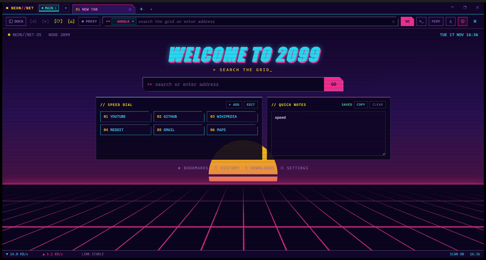
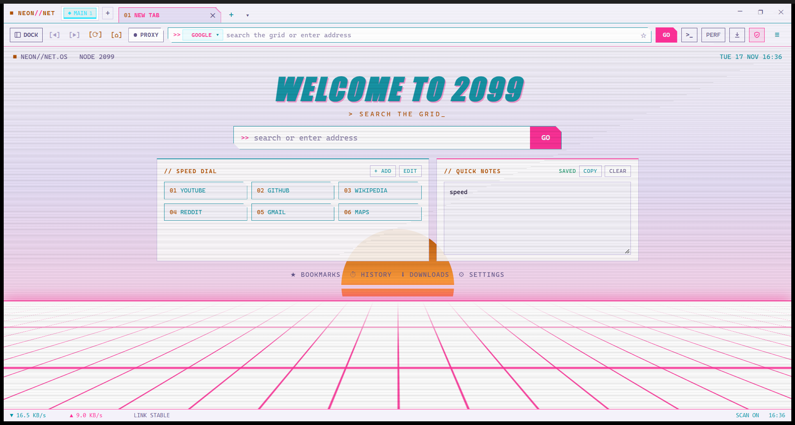
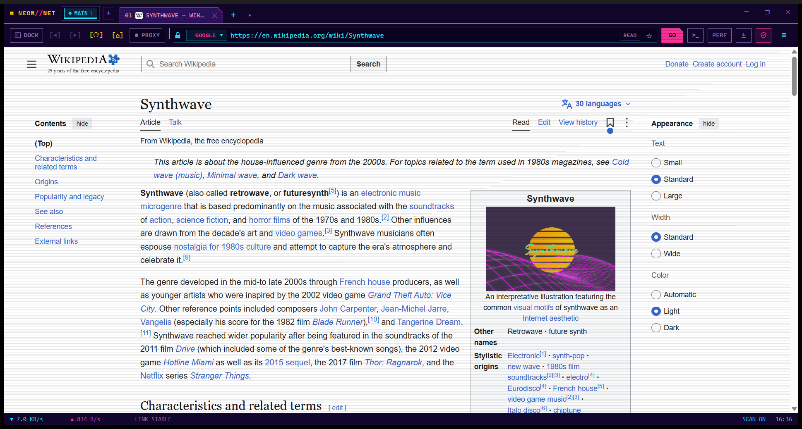
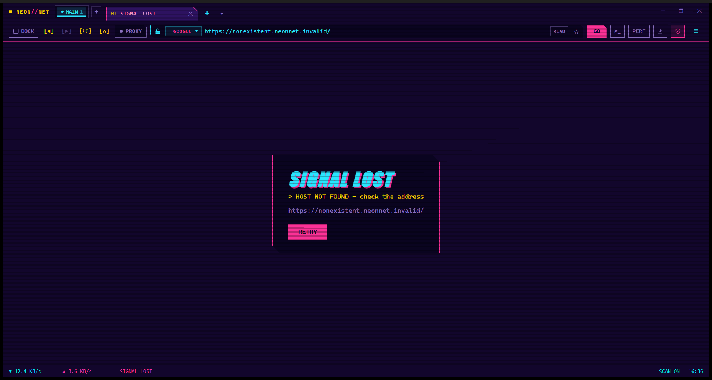

# NeonNet

A synthwave / cyber-HUD themed web browser for Windows. Available in **Dark Synthwave** and **Light (Cyber Paper)** themes with customizable neon accents, clipped window corners, CRT scanlines, and an animated new tab page with a sunset, moving grid, Speed Dial, and Quick Notes.

NeonNet ships its own Chromium engine. It does not need Edge, WebView2 or any other runtime.

> Built and vibecoded with **Claude** and **Antigravity (Gemini)**.










## Features

- **Tabs & Workspaces:** open, close, switch, drag to reorder, pin, mute, duplicate, horizontal wheel scroll, hover tooltips, and Opera GX-style **Workspaces** for organizing tab groups. Popups open as tabs, and you can optionally restore your last session on startup.
- **Split View (`Ctrl+Alt+S`), Reader Mode (`Ctrl+Alt+R`) & Social Dock (`Ctrl+Alt+W`):** view two tabs side-by-side with a draggable divider, switch any article into a clean Reader Mode (`NEON`, `DARK`, `SEPIA`, `LIGHT` themes), and open a resizable left Social Dock for WhatsApp, Instagram, and Discord.
- **Dark & Light Themes + Custom Accents:** switch between **Dark Synthwave** and **Light (Cyber Paper)** UI modes, pick or customize neon accent colors, enable **Force Dark Mode** on websites with per-site exceptions, and remap keyboard shortcuts in Settings.
- **Turbo Multi-Connection Downloads:** IDM-style parallel byte-range downloads (`4` / `8` / `16` connections) routed through Chromium's network stack with zero-freeze NTFS sparse file I/O, a toolbar Downloads popover with live segmented progress bars, and auto-categorized folders in `Downloads\NeonNet Download`.
- **Command Palette (`Ctrl+K`):** instant fuzzy search across open tabs, workspaces, bookmarks, history, settings, and browser commands.
- **Ad & Tracker Shield & YouTube Ad Skipper:** toolbar Shield popover with independent **Block Ads** and **Block Trackers** toggles, per-site exceptions, and a native C++ YouTube ad skipper.
- **Performance Panel (`Ctrl+Shift+M`):** docked sidebar with 24-sample SVG RAM/CPU sparklines, memory cleaner, sleeping tabs, Battery Saver (`ON/OFF` and `Auto <=25%`), and optional RAM, CPU, and network download limiters.
- **New Tab Page:** animated sunset and perspective grid with customizable **Speed Dial** tiles and a persistent **Quick Notes** scratchpad.
- **Address Bar & Search:** built-in Google and custom search engines (`%s` / `{query}`), inline bookmarks/history suggestions, and a clickable zoom percentage badge.
- **Scanlines, Smooth Scrolling & HUD Status Bar:** optional CRT line effect (`SCAN`), animated wheel and keyboard scrolling, and live network download/upload speed in the status bar.
- **"SIGNAL LOST" Error Page & Warnings:** themed error page with a `RETRY` button when a site fails to load, plus themed certificate and HTTPS-only warnings.
- **Privacy & Security:** incognito windows (`Ctrl+Shift+N`), clear browsing data, HTTPS-only mode, proxy profiles, per-site permissions (`neonnet://permissions`), and saved passwords encrypted with your Windows account (DPAPI).
- **Extensions (Userscripts):** `Ctrl+Shift+E` (`neonnet://extensions`) manages `.user.js` userscripts with `@match`/`@include`/`@exclude`, `@run-at`, and `GM_*` APIs.
- **Find in Page, Bookmarks, History & Downloads:** `Ctrl+F`, `Ctrl+D`, `Ctrl+H`, `Ctrl+Shift+O` for bookmarks (with nested folders, bookmarks bar via `Ctrl+Shift+B`, and HTML import/export), `Ctrl+J` for downloads, and `Ctrl+Shift+T` to reopen closed tabs.
- **Developer Tools & Single Window:** docked DevTools (`F12`), Chromium sandbox enabled for renderer/GPU processes, and `NeonNet.exe <url>` opens new tabs in the existing window.
- **Installer & Automatic Updates:** per-user by default (no admin rights needed) or all-users install, default-browser registration, and background auto-updates verified against SHA-256 checksums.

## Download and install

Download `NeonNet-Setup.exe` from the Releases page, run it and click **INSTALL**. See the [user guide](docs/USER-GUIDE.md) for details.

Requirements: Windows 10 version 1803 or newer (64-bit), or Windows 11.

## Building from source

```bash
powershell -ExecutionPolicy Bypass -File build.ps1
```

Requires Visual Studio 2022 with the "Desktop development with C++" workload. The Chromium Embedded Framework is downloaded automatically on the first build. Full instructions are in [docs/BUILD.md](docs/BUILD.md).

## Documentation

| Document | Contents |
|---|---|
| [User guide](docs/USER-GUIDE.md) | Installing, features, shortcuts, data locations, uninstalling, FAQ |
| [Building](docs/BUILD.md) | Prerequisites, build steps, outputs, troubleshooting |
| [Architecture](docs/ARCHITECTURE.md) | How it works inside: processes, window, tabs, UI messaging |
| [Installer](docs/INSTALLER.md) | Installer format, install and uninstall flow |
| [Maintenance and releases](docs/MAINTENANCE.md) | Updating Chromium, release checklist, publishing on GitHub |
| [Changelog](CHANGELOG.md) | Version history |
| [Security policy](SECURITY.md) | How to report a vulnerability |
| [Third-party notices](THIRD_PARTY_NOTICES.md) | Third-party components and their licenses |

## Repository layout

```
neonnet-browser/
├─ src/
│  ├─ main.cpp          all browser logic
│  ├─ updater.cpp/.h    update check, download and checksum
│  ├─ store.cpp/.h      history, bookmarks (with folders & HTML import/export) and downloads
│  ├─ perf.cpp/.h       process memory/CPU sampling and limiters
│  ├─ crash.cpp/.h      unhandled exception and subprocess crash log
│  ├─ userscripts.cpp/.h  .user.js userscript parser, matcher and storage
│  ├─ browserreg.h      default browser registry helpers
│  ├─ resource.h        resource IDs and version
│  ├─ app.rc            icon, embedded UI pages, version info
│  ├─ app.manifest      Windows manifest (DPI awareness, common controls)
│  └─ neonnet.ico       application icon
├─ ui/
│  ├─ chrome.html       tab strip, address bar and bookmarks bar
│  ├─ newtab.html       new tab page
│  ├─ history.html      history page
│  ├─ downloads.html    downloads page
│  ├─ settings.html     settings page
│  ├─ bookmarks.html    bookmarks page
│  ├─ performance.html  performance panel
│  ├─ passwords.html    saved passwords page
│  ├─ permissions.html  site permissions page
│  ├─ extensions.html   extensions (userscripts) page
│  ├─ warning.html      certificate and HTTPS-only warning page
│  └─ blocklist.txt     tracker and ad domain list
├─ installer/
│  ├─ setup.cpp         installer
│  └─ setup.rc
├─ tools/
│  ├─ fetch_cef.ps1     downloads the Chromium Embedded Framework
│  ├─ rescopy.cpp       puts the icon and version info into NeonNet.exe
│  └─ make_icon.ps1     regenerates neonnet.ico
├─ docs/                documentation
├─ build.ps1            builds everything
└─ cef_version.txt      pinned Chromium Embedded Framework version
```

## Limitations

- DRM content (Netflix, Disney+, Spotify web player) does not play. NeonNet warns in the status bar when a site asks for it.
- H.264 and AAC are not built in (patent licences), so files such as most `.mp4` cannot play inside NeonNet. VP9, AV1, Opus and MP3 work, which covers YouTube. A video NeonNet cannot play can be opened in your own media player instead (see the user guide).
- No account sync or Chrome Web Store (`.crx`) extensions (NeonNet uses built-in `.user.js` userscripts instead).

## License

NeonNet is released under the [MIT License](LICENSE). Copyright (c) 2026 cahyata.

NeonNet is built on the Chromium Embedded Framework and Chromium, which have their own licenses. See [THIRD_PARTY_NOTICES.md](THIRD_PARTY_NOTICES.md); the notices are also installed with the app.
