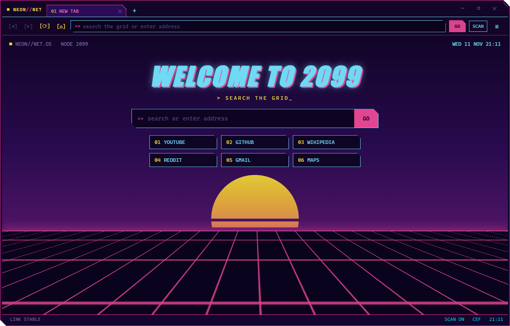
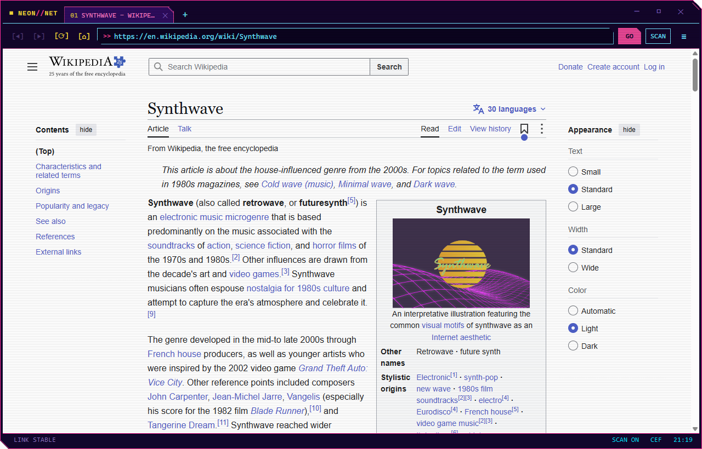

# NeonNet

A synthwave / cyber-HUD themed web browser for Windows. Dark purple, neon pink and cyan, clipped window corners, CRT scanlines, and a new tab page with a sunset and a moving grid.

NeonNet ships its own Chromium engine. It does not need Edge, WebView2 or any other runtime.





## Features

- **Tabs:** open, close, switch, and open links in a new tab. Popups (for example sign-in windows) open as tabs.
- **Address bar:** type an address or search words (Google search).
- **Theme:** clipped-corner window frame and a HUD-style status bar.
- **Scanlines:** a CRT line effect over every page, toggled with the `SCAN` button.
- **"SIGNAL LOST" error page:** shown when a site fails to load, with a RETRY button.
- **Standard browser features:** fullscreen (including video), zoom, print, downloads with a save dialog, and developer tools.
- **Single window:** running `NeonNet.exe <url>` while NeonNet is open adds a tab to the existing window.
- **Chromium sandbox enabled:** renderer and GPU processes run isolated.
- **Per-user installer:** no admin rights needed, uninstall from Settings > Apps.
- **Find in page, bookmarks and history:** Ctrl+F, Ctrl+D, Ctrl+H, and Ctrl+Shift+T to reopen a closed tab.
- **Automatic updates:** new releases are downloaded in the background, checked against a SHA-256 checksum, and installed when NeonNet closes. Can be turned off.

## Download and install

Download `NeonNet-Setup.exe` from the Releases page, run it and click **INSTALL**. See the [user guide](docs/USER-GUIDE.md) for details.

Requirements: Windows 10 version 1803 or newer (64-bit), or Windows 11.

## Building from source

```bash
powershell -ExecutionPolicy Bypass -File build.ps1
```

Requires Visual Studio 2022 with the "Desktop development with C++" workload. The Chromium Embedded Framework is downloaded automatically on the first build. Full instructions are in [docs/BUILD.md](docs/BUILD.md).

## Documentation

| Document | Contents |
|---|---|
| [User guide](docs/USER-GUIDE.md) | Installing, features, shortcuts, data locations, uninstalling, FAQ |
| [Building](docs/BUILD.md) | Prerequisites, build steps, outputs, troubleshooting |
| [Architecture](docs/ARCHITECTURE.md) | How it works inside: processes, window, tabs, UI messaging |
| [Installer](docs/INSTALLER.md) | Installer format, install and uninstall flow |
| [Maintenance and releases](docs/MAINTENANCE.md) | Updating Chromium, release checklist, publishing on GitHub |
| [Changelog](CHANGELOG.md) | Version history |
| [Security policy](SECURITY.md) | How to report a vulnerability |
| [Third-party notices](THIRD_PARTY_NOTICES.md) | Third-party components and their licenses |

## Repository layout

```
neonnet-browser/
├─ src/
│  ├─ main.cpp          all browser logic
│  ├─ updater.cpp/.h    update check, download and checksum
│  ├─ store.cpp/.h      history and bookmarks
│  ├─ resource.h        resource IDs and version
│  ├─ app.rc            icon, embedded UI pages, version info
│  ├─ app.manifest      Windows manifest (DPI awareness, common controls)
│  └─ neonnet.ico       application icon
├─ ui/
│  ├─ chrome.html       tab strip and address bar
│  ├─ newtab.html       new tab page
│  ├─ history.html      history page
│  └─ bookmarks.html    bookmarks page
├─ installer/
│  ├─ setup.cpp         installer
│  └─ setup.rc
├─ tools/
│  ├─ fetch_cef.ps1     downloads the Chromium Embedded Framework
│  ├─ rescopy.cpp       puts the icon and version info into NeonNet.exe
│  └─ make_icon.ps1     regenerates neonnet.ico
├─ docs/                documentation
├─ build.ps1            builds everything
└─ cef_version.txt      pinned Chromium Embedded Framework version
```

## Limitations

- DRM content (Netflix, Disney+, Spotify web player) does not play.
- No account sync, password manager or Chrome Web Store extensions.
- Bookmarks are a flat list (no folders), and the address bar does not suggest from history yet.

## License

NeonNet is released under the [MIT License](LICENSE). Copyright (c) 2026 cahyata.

NeonNet is built on the Chromium Embedded Framework and Chromium, which have their own licenses. See [THIRD_PARTY_NOTICES.md](THIRD_PARTY_NOTICES.md); the notices are also installed with the app.
