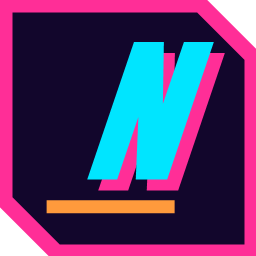
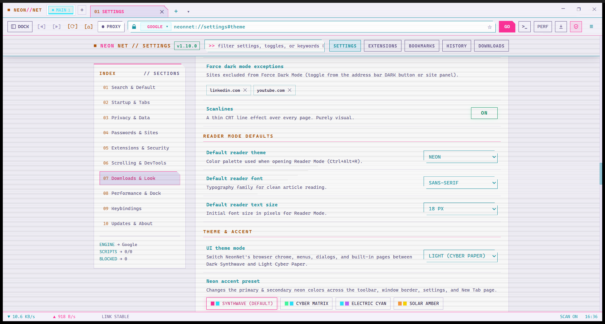

<!-- prettier-ignore -->
<div align="center">



# NeonNet

**A synthwave / cyber-HUD themed web browser for Windows, with its own Chromium engine.**

[](https://github.com/cahyata/neonnet-browser/releases/latest)
-00bcd4?style=flat-square)


[](LICENSE)

[Download](https://github.com/cahyata/neonnet-browser/releases/latest) • [Features](#features) • [Build from source](#build-from-source) • [User guide](https://cahyata.github.io/neonnet-browser/)


</div>

NeonNet is a native Win32 browser built on the [Chromium Embedded Framework](https://github.com/chromiumembedded/cef). It does not need Edge, WebView2 or any other runtime. The whole interface is its own: clipped window corners, neon accents, CRT scanlines, and an animated new tab page, in a **Dark Synthwave** or **Light (Cyber Paper)** theme.

> Built and vibecoded with **Claude** and **Antigravity (Gemini)**.

## Features

### Tabs and navigation

- **Workspaces** to group tabs, with pinning, drag to reorder, muting, duplicating, reopening closed tabs and session restore.
- **Split View** for two tabs side by side, and a **Social Dock** for WhatsApp, Instagram and Discord.
- **Command Palette** (`Ctrl+Shift+P`) to search open tabs, bookmarks, history and browser commands.
- **Address bar** with local suggestions from bookmarks and history, and custom search engines.
- **Reader Mode** with four themes and adjustable fonts.
- **Bookmarks** with folders, a bookmarks bar and HTML import/export, plus history and find in page.

### Privacy and security

- **Shield** with separate ad and tracker blockers, per-site exceptions and a built-in YouTube ad skipper.
- **Incognito windows**, HTTPS-only mode, certificate warnings and per-site permissions.
- **Tracking protection:** tracking parameters are removed from addresses, third-party cookies can be blocked and cross-site referrers trimmed.
- **DNS-over-HTTPS** and a browser-only **proxy tunnel** (SOCKS5, HTTPS or HTTP profiles).
- **Saved passwords** encrypted with your Windows account (DPAPI).
- The Chromium sandbox stays enabled.

### Downloads and performance

- **Multi-connection downloads** (4, 8 or 16 parallel connections), sorted into folders by file type.
- **Performance panel** with RAM and CPU graphs per tab, sleeping tabs and memory cleanup.
- **Limiters** for RAM, background CPU and download speed, and a **Battery Saver**.

### Customization

- Neon accent presets or your own colors, scanlines, and **Force Dark Mode** with per-site exceptions.
- **Userscripts** (`.user.js`) with `GM_*` APIs, a built-in editor and drag-and-drop import.
- Remappable keyboard shortcuts, smooth scrolling and docked developer tools.
- Interface in **English** or **Bahasa Indonesia**.

### Accessibility

- High contrast theme, reduced motion, a minimum font size for web pages and screen reader support.
- Visible keyboard focus, skip links and headings on NeonNet's own pages.

## Screenshots

| Browsing | Settings, light theme |
|---|---|
|  |  |
| **New tab, light theme** | **Error page** |
|  |  |

## Getting started

You need Windows 10 version 1803 or newer (64-bit), or Windows 11, and about 450 MB of disk space.

1. Download `NeonNet-Setup.exe` from the [latest release](https://github.com/cahyata/neonnet-browser/releases/latest).
2. Run it and click **INSTALL**. Administrator rights are only needed if you install for all users.
3. Launch NeonNet. A per-user install updates itself, and verifies each download against its SHA-256 checksum.

> [!NOTE]
> The installer is not code signed, so Windows SmartScreen may warn you. If you trust where the file came from, click **More info**, then **Run anyway**.

### Keyboard shortcuts

| Keys | Action |
|---|---|
| `Ctrl+Shift+P` | Command Palette |
| `Ctrl+T` / `Ctrl+W` / `Ctrl+Shift+T` | New, close and reopen tab |
| `Ctrl+Shift+N` | Incognito window |
| `Ctrl+Alt+S` | Split View |
| `Ctrl+Alt+R` | Reader Mode |
| `Ctrl+Alt+W` | Social Dock |
| `Ctrl+Shift+M` | Performance panel |
| `Ctrl+Shift+E` | Userscripts |
| `Ctrl+,` | Settings |

The [user guide](docs/USER-GUIDE.md) has the full list. Press `F1` in the browser to open it online.

## Build from source

Install Visual Studio 2022 (or Build Tools) with the **Desktop development with C++** workload. CMake, Python and Ninja are not needed.

```bash
git clone https://github.com/cahyata/neonnet-browser.git
cd neonnet-browser
powershell -ExecutionPolicy Bypass -File build.ps1
```

The first build downloads the pinned CEF version (about 175 MB) and takes a few minutes. Allow about 2 GB of disk space.

| Output | Contents |
|---|---|
| `build/app/NeonNet.exe` | Ready-to-run app |
| `dist/NeonNet-Setup.exe` | Installer, with its `.sha256` checksum |

> [!TIP]
> Use `build.ps1 -NoInstaller` for faster test builds, `-Test` to run the tests, and `-Clean` to rebuild from scratch.

> [!IMPORTANT]
> A test build in `build/app` uses the same profile as an installed copy (`%LOCALAPPDATA%\NeonNet\Profile`).

### Project structure

```
src/         browser source (C++): window, tabs, settings, site rules, storage, updater, userscripts
tests/       tests of the modules that need neither CEF nor a window
ui/          interface and built-in pages (HTML), embedded into NeonNet.dll
installer/   the setup program
design/      design tokens and component catalog
tools/       CEF download, icon, design token and blocklist scripts
docs/        documentation
```

## Limitations

- DRM video and audio (Netflix, Disney+, the Spotify web player) does not play.
- H.264 and AAC are not included because of patent licenses, so most `.mp4` files can only be opened in your own media player. VP9, AV1, Opus and MP3 work, which covers YouTube.
- Chrome Web Store extensions and account sync are not supported. Userscripts cover many extension use cases.
- Sites that ask for a user name and password through HTTP sign-in do not load.

## Documentation

| Document | Contents |
|---|---|
| [User guide](docs/USER-GUIDE.md) | Features, shortcuts, data locations, uninstalling, FAQ |
| [Building](docs/BUILD.md) | Prerequisites, build steps, troubleshooting |
| [Architecture](docs/ARCHITECTURE.md) | Processes, window, tabs and UI messaging |
| [Installer](docs/INSTALLER.md) | Installer format, install and uninstall flow |
| [Maintenance](docs/MAINTENANCE.md) | Updating Chromium and publishing releases |
| [Changelog](CHANGELOG.md) | What changed in each version |
| [Glossary](GLOSSARY.md) | The words the code uses for its domain |
| [Third-party notices](THIRD_PARTY_NOTICES.md) | Components used by NeonNet and their licenses |
